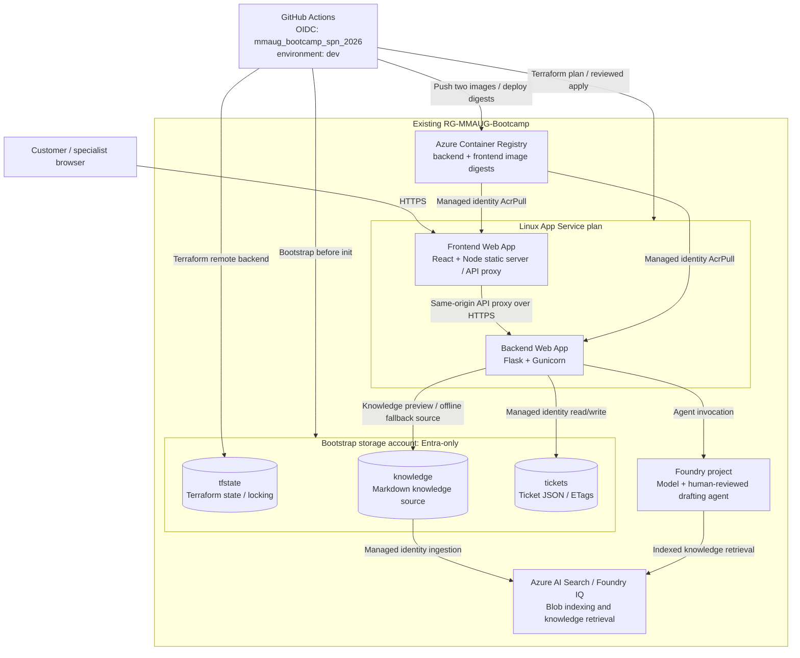

# MMAUG Bootcamp 2026: Customer Support Agent

**27 October 2026: Cloud Architecture and DevOps CI/CD**, building on the
17 October Python, Docker and Terraform foundations.

Customers submit queries in React. The Flask backend triages them, drafts a
knowledge-grounded answer and assigns a human specialist. Specialists edit,
approve or reassign; customers see only the approved response in the portal.
Billing routes to Aye Chan, technical to Min Thu, account to Su Mon and general
to Kyaw Zin.

## Architecture

All cloud resources belong to the **existing `RG-MMAUG-Bootcamp`** resource group.
Terraform reads that group; it must not create or destroy it. The frontend and
backend are **two separate App Service web apps**, with no VM deployment.



The source knowledge is in [support-agent/knowledge](support-agent/knowledge).
Search indexing and agent grounding are separate from ticket storage.
The state container is never granted to either application identity.
See [architecture details](docs/architecture.md).

## Run locally without Azure

Requirements: Python 3.10+, Node.js 22+, npm and curl.
Commands start at this repository root.

```bash
(cd support-agent/frontend && npm ci && npm run build)
# Create only when absent; reuse a working backend environment.
python3 -m venv support-agent/backend/.venv
support-agent/backend/.venv/bin/pip install -r support-agent/backend/requirements.txt
cd support-agent/backend
export AI_MODE=off STORAGE_ACCOUNT_URL='' AZURE_STORAGE_CONNECTION_STRING=''
export SPECIALIST_API_TOKEN="$(.venv/bin/python -c 'import secrets; print(secrets.token_urlsafe(32))')"
.venv/bin/python app.py
```

Open `http://127.0.0.1:8000/` for the customer portal and
`http://127.0.0.1:8000/#/specialist` for the console. Enter the token privately.
Ctrl+C stops the development server. No paid AI is used in this mode.
The empty storage settings override cloud values in the local environment file.
Local data persists under `support-agent/backend/.data`.

For frontend hot reload, keep Flask on port 8000 and in another terminal run:

```bash
cd support-agent/frontend
npm run dev -- --host 127.0.0.1
```

Vite prints its URL, normally `http://127.0.0.1:5173`. It proxies API calls to
Flask. For a **two-container local rehearsal** matching the cloud split:

```bash
export SPECIALIST_API_TOKEN="$(python3 -c 'import secrets; print(secrets.token_urlsafe(32))')"
docker compose -f support-agent/compose.split.yaml up --build -d
curl -fsS http://127.0.0.1:8090/health
# Customer portal / specialist console: http://127.0.0.1:8090/
docker compose -f support-agent/compose.split.yaml down
```

This preserves the named data volume. Do not add `-v` unless ticket deletion is
intended. The original single-container Compose and local Docker Terraform lab
remain available for the foundations exercise.

## Deploy infrastructure through GitHub Actions

[infra.yml](.github/workflows/infra.yml) uses the existing federated identity and
GitHub environment **`dev`**. No client secret is required. An administrator must
prepare role assignments and environment protections before a live run.
No workflow grants itself additional permissions.

1. Verify the OIDC subject for this repository's `dev` environment. The existing
   credential includes immutable owner/repository IDs; do not replace it with a
   guessed subject string. GitHub CLI account: `imohweb`.
2. Configure the `dev` variables required by the workflow, including
   `AZURE_CLIENT_ID`, `AZURE_TENANT_ID`, `AZURE_SUBSCRIPTION_ID`,
   `AZURE_RESOURCE_GROUP=RG-MMAUG-Bootcamp`, a globally unique storage account
   name and a unique resource prefix. See [skills.md](skills.md) for the runbook.
3. Add required reviewers and branch restrictions to `dev`. At inspection time
   it had **no protection rules or variables/secrets configured**.
4. Review the workflow and its plan/apply inputs before dispatch. Bootstrap
   creates/reuses the storage account and three private containers **before**
   Terraform initialization. The state uses Entra ID/OIDC, not account keys.
5. Review the saved Terraform plan. Apply only the reviewed plan through the
   workflow's approval boundary. This provisions the shared App Service plan,
   two web apps, ACR, Foundry resources and Search integration.
6. Index the uploaded knowledge and check successful ingestion before releasing
   the application. Do not treat an empty index as a successful AI deployment.

### Required Azure permissions

The existing SP has **Contributor on `RG-MMAUG-Bootcamp`**. That permits resource
management there but not RBAC assignments or Blob data access. An authorized
administrator must additionally grant the needed permissions:

- Scoped **Role Based Access Control Administrator** (or an equivalent,
  preferably constrained role) for Terraform's role assignments within this RG.
- **Storage Blob Data Contributor** for bootstrap/state access, scoped to the
  account once it exists; bootstrap of a new account needs an explicitly
  approved inheritance scope or a separate privileged bootstrap.
- Search/Foundry data-plane roles as required by the indexing/agent setup.

Do not grant subscription Owner merely to bypass missing prerequisites.
The existing RG and bootstrapped state storage are outside Terraform destroy
ownership. **Earlier local state must be reviewed and migrated before first
pipeline use**; never start from empty remote state over existing resources.

## Deploy the application to the cloud

[CI](.github/workflows/ci.yml) runs backend, React, proxy, container and Terraform
checks. Successful pushes to `main` call [deployment](.github/workflows/deploy.yml)
using environment `dev`. Releases build two targets from the
[Dockerfile](support-agent/Dockerfile):

- `backend` -> ACR repository `support-agent-backend`
- `frontend` -> ACR repository `support-agent-frontend`

Set `ACR_NAME`, `BACKEND_WEB_APP_NAME`, `FRONTEND_WEB_APP_NAME` and the Azure
login/subscription/resource group variables from infrastructure outputs.
Set **`SPECIALIST_API_TOKEN` as an environment secret**, random and 32+ characters.
The frontend uses `BACKEND_ORIGIN` to proxy `/api` and `/health` to the backend;
no browser cross-origin token handling is needed.

The shared [deployment script](scripts/deploy-azure.sh) deploys immutable digests
to both apps, verifies backend and proxied frontend API contracts, checks
authenticated knowledge access and verifies the React shell. Finish with a
synthetic ticket: submit, inspect grounding, approve, and confirm the exact reply.

[Azure Pipelines](pipelines/azure-pipelines.yml) remains an alternative
**application** release path, not a second infrastructure owner. Configure its
WIF service connection and variable group separately; GitHub federation does
not authenticate Azure DevOps. Run only one orchestrator against a target.

## Tests and reusable instructions

```bash
(cd support-agent/backend && .venv/bin/python -m unittest -v)
(cd support-agent/frontend && npm test && npm run build && node --test server.test.mjs)
bash tests/test-deploy.sh
bash tests/test-bootstrap-state.sh
```

Read [skills.md](skills.md) for standardized agent/audience instructions:
local startup, cloud deployment, permission boundaries, state ownership and
validation. [AGENT.md](AGENT.md) is the compatibility entry point.

| Material | Purpose |
| --- | --- |
| [Setup](docs/00-start-here.md) | Local foundations |
| [Code walkthrough](docs/01-python-explained.md) | Ticket lifecycle and application modules |
| [Docker](docs/02-docker.md) | Packaging and the local Terraform lab |
| [Terraform](docs/03-terraform-azure.md) | Infrastructure ownership and remote state |
| [Pipelines](docs/04-pipelines.md) | OIDC, infrastructure and application release |
| [DevSecOps](docs/05-devsecops-codeql.md) | CodeQL and security controls |
| [Foundry](docs/06-foundry-demo.md) | Indexed knowledge and drafting modes |
| [Participant PDF](docs/MMAUG_Python_docker_terraform_Fundamentals_Participant.pdf) | Workshop slides |

## Limits, costs and cleanup

This remains a teaching solution: shared specialist token, public backend
endpoint, no public ticket rate limit, portal-only delivery, no private
networking and no per-user customer sign-in. AI failures use the explicit
template fallback; a fallback response does not prove Search or the model works.
Foundry IQ preview features may have region/model/API constraints.

App Service plan, ACR, Storage, Search and model usage incur charges. Stopping
the apps does not stop plan/Search billing. Never delete the shared resource
group or remote-state storage as a shortcut. Review a destroy plan, preserve
state until owned resources are gone, and clean bootstrapped storage separately
only when explicitly approved. Never commit credentials, `.env-local`, state,
plan files, ticket data or real environment values in `dev.tfvars`.
