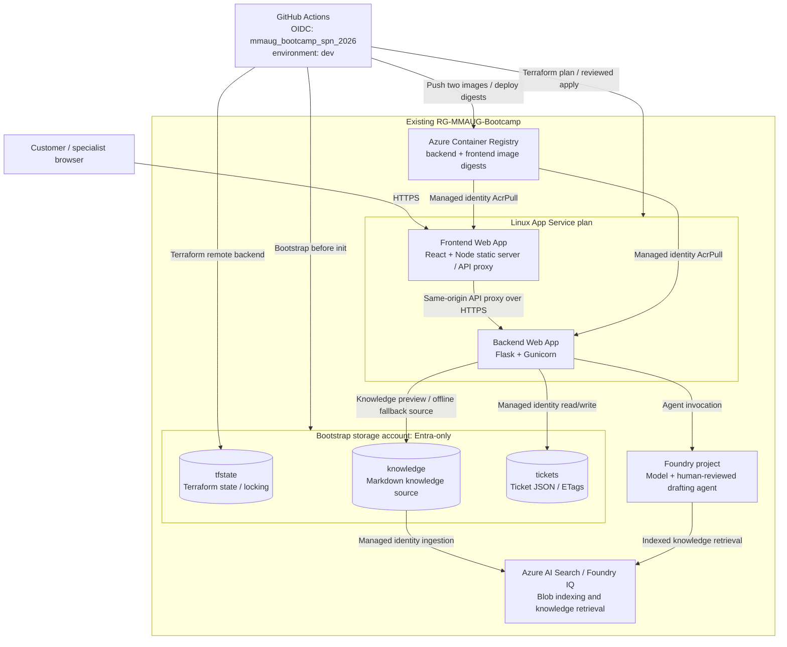

# MMAUG Bootcamp 2026: Customer Support Agent

**27 October 2026: Cloud Architecture and DevOps CI/CD**, building on the
17 October Python, Docker and Terraform foundations.

Customers submit queries in React. The Flask backend triages them, drafts a
knowledge-grounded answer and assigns a human specialist. Specialists edit,
approve or reassign; customers see only the approved response in the portal.
Billing routes to Aye Chan, technical to Min Thu, account to Su Mon and general
to Kyaw Zin.

| Who | Where | What they do |
| --- | --- | --- |
| Customer | `/` (**Get help**) | Submit a query, then track it with the ticket ID (`SUP-…`) and the private ticket key shown after submission. |
| Specialist | `/#/specialist` (**Specialist console**) | Sign in with the specialist token, review the AI draft and its grounding, edit, approve or reassign. |

The backend `AI_MODE` selects how drafts are produced:

| `AI_MODE` | Drafting |
| --- | --- |
| `off` | Knowledge templates only; no paid AI (local default). |
| `model` | Direct Azure OpenAI model call grounded on knowledge excerpts. |
| `agent` | Foundry agent grounded through the Azure AI Search knowledge base (cloud default). |

The four knowledge documents (billing, technical, account, general) live in
[support-agent/knowledge](support-agent/knowledge).

## Architecture

All cloud resources belong to the **existing `RG-MMAUG-Bootcamp`** resource group.
Terraform reads that group; it must not create or destroy it. The frontend and
backend are **two separate App Service web apps**, with no VM deployment.



Search indexing and agent grounding are separate from ticket storage.
Azure AI Search may run in a different region from Foundry (`SEARCH_LOCATION`)
when the Foundry region has no Search capacity; the shared resource group's own
region is used for the App Service plan, web apps, ACR and storage.
The ACR admin user is disabled: both web apps pull image digests with the shared
user-assigned identity (AcrPull), and GitHub Actions pushes with OIDC.
The state container is never granted to either application identity.
See [architecture details](docs/architecture.md).
For larger, presentation-friendly diagrams of runtime, Azure resources, CI/CD
and optional extensions, see [expanded architecture views](docs/architecture-expanded.md).

## Run locally without Azure

Requirements: Python 3.10+, Node.js 22+, npm and curl.
Commands start at this repository root.

```bash
(cd support-agent/frontend && npm ci && npm run build)
# Create only when absent; reuse a working backend environment.
python3 -m venv support-agent/backend/.venv
support-agent/backend/.venv/bin/pip install -r support-agent/backend/requirements.txt
cd support-agent/backend
export AI_MODE=off STORAGE_ACCOUNT_URL='' AZURE_STORAGE_CONNECTION_STRING=''
export SPECIALIST_API_TOKEN="$(.venv/bin/python -c 'import secrets; print(secrets.token_urlsafe(32))')"
.venv/bin/python app.py
```

Open `http://127.0.0.1:8000/` for the customer portal and
`http://127.0.0.1:8000/#/specialist` for the console. Enter the token privately.
Ctrl+C stops the development server. No paid AI is used in this mode.
The empty storage settings override cloud values in the local environment file.
Local data persists under `support-agent/backend/.data`.

For frontend hot reload, keep Flask on port 8000 and in another terminal run:

```bash
cd support-agent/frontend
npm run dev -- --host 127.0.0.1
```

Vite prints its URL, normally `http://127.0.0.1:5173`. It proxies API calls to
Flask. For a **two-container local rehearsal** matching the cloud split:

```bash
export SPECIALIST_API_TOKEN="$(python3 -c 'import secrets; print(secrets.token_urlsafe(32))')"
docker compose -f support-agent/compose.split.yaml up --build -d
curl -fsS http://127.0.0.1:8090/health
# Customer portal / specialist console: http://127.0.0.1:8090/
docker compose -f support-agent/compose.split.yaml down
```

This preserves the named data volume. Do not add `-v` unless ticket deletion is
intended. The original single-container Compose and local Docker Terraform lab
remain available for the foundations exercise.

## Deploy infrastructure through GitHub Actions

[infra.yml](.github/workflows/infra.yml) uses the existing federated identity and
GitHub environment **`dev`**. No client secret is required. An administrator must
prepare role assignments and environment protections before a live run.
No workflow grants itself additional permissions.

1. Verify the OIDC subject for this repository's `dev` environment. The existing
   credential includes immutable owner/repository IDs; do not replace it with a
   guessed subject string. GitHub CLI account: `imohweb`.
2. Configure the `dev` environment variables (see the table below).
   See [skills.md](skills.md) for the runbook.
3. Add required reviewers and a main-only branch restriction to `dev`. Every
   `dev` job (plan, apply, release) then waits for reviewer approval.
4. Review the workflow and its plan/apply inputs before dispatch. Bootstrap
   creates/reuses the storage account and three private containers **before**
   Terraform initialization. The state uses Entra ID/OIDC, not account keys.
5. Review the saved Terraform plan. Apply only the reviewed plan through the
   workflow's approval boundary. This provisions the shared App Service plan,
   two web apps, ACR, Foundry resources and Search integration.
6. During apply, Terraform uploads the knowledge files and runs two bridge
   scripts: [setup_knowledge_index.py](support-agent/backend/setup_knowledge_index.py)
   (index, blob knowledge source and indexer, knowledge base and project MCP
   connection) and [manage_agent.py](support-agent/backend/manage_agent.py)
   (Foundry agent). In GitHub Actions they authenticate through
   [provisioning_credential.py](support-agent/backend/provisioning_credential.py),
   which requests a fresh GitHub OIDC assertion for every token exchange, so
   long applies (Search creation can take ~10 minutes) do not fail on an expired
   login assertion.
7. Check that the indexer succeeded and the index holds documents before
   releasing the application. Do not treat an empty index as a successful AI
   deployment. Index statistics can lag; a direct search query shows the true
   document count.

| `dev` variable / secret | Used by | Value |
| --- | --- | --- |
| `AZURE_CLIENT_ID`, `AZURE_TENANT_ID`, `AZURE_SUBSCRIPTION_ID` | all Azure workflows | OIDC deployment SP and target subscription |
| `AZURE_RESOURCE_GROUP` | all Azure workflows | `RG-MMAUG-Bootcamp` (existing) |
| `STATE_ACCOUNT` | infra | Globally unique storage account for state, knowledge and tickets |
| `RESOURCE_PREFIX` | infra | 6-18 lowercase letters/digits, starting with a letter |
| `WEB_IDENTITY_RESOURCE_ID` | infra | Existing user-assigned identity for both web apps |
| `FOUNDRY_LOCATION` | infra (optional) | Foundry/model region; default `eastus2` |
| `SEARCH_LOCATION` | infra (optional) | Azure AI Search region; defaults to `FOUNDRY_LOCATION` |
| `ACR_NAME`, `BACKEND_WEB_APP_NAME`, `FRONTEND_WEB_APP_NAME` | deploy | Terraform outputs `acr_name`, `backend_web_app_name`, `frontend_web_app_name` |
| `SPECIALIST_API_TOKEN` (**secret**) | deploy, CI | Random, 32+ characters; the specialist console sign-in token |

No client secret, ACR admin credential or `CORS_ORIGIN` setting is needed: the
frontend proxies `/api` and `/health` to the backend on the same origin, and
the application does not read `CORS_ORIGIN`.

For a completed plan-only run, its dispatch inputs cannot be changed.
[apply-reviewed-plan.yml](.github/workflows/apply-reviewed-plan.yml) provides a
separate manual, protected path for that existing artifact. Supply its run ID,
successful attempt, full source SHA and immutable artifact ID. It verifies the
same-repository manual `infra.yml` run on `main`, successful plan job, artifact
creation within that attempt, expiry, SHA-256 digest and archive contents.
Missing metadata or unreadable protection settings fail closed. It checks out
the reviewed source SHA and uses the same Terraform version and locked
providers to apply that exact plan, without bootstrap or re-planning. The
`dev` reviewer, main-only restriction, external-access attestation and shared
infrastructure concurrency group still apply. Stale state must fail rather
than trigger an automatic re-plan; a new plan needs a new review. This workflow
does not release either application.

The infrastructure defaults to **`gpt-6.1-sol`**, version **`2026-09-29`**,
deployed as `demo-model` (`GlobalStandard`, capacity 10). The Foundry region
defaults to `eastus2` and is overridden by `FOUNDRY_LOCATION`.
The model is selected in [variables.tf](infra/azure/variables.tf) and provisioned
by [foundry.tf](infra/azure/foundry.tf); Search is in [search.tf](infra/azure/search.tf).
See [where the model is configured and called](docs/06-foundry-demo.md#where-the-model-is-configured-and-called)
for the agent and backend call sites. Check regional model/IQ support and quota
before apply; application pipelines do not provision models.

> **Known limitation:** the Azure AI Search knowledge base accepts only a
> limited set of planner models, and `gpt-6.1-sol` is not one of them. If
> `setup_knowledge_index.py` fails at the knowledge-base step, create the
> knowledge base without a model, using `retrievalReasoningEffort: minimal` and
> `outputMode: extractiveData`. The agent still uses `gpt-6.1-sol` for drafting.
> Alternatively, set a supported planner model for the knowledge base.

### Required Azure permissions

Terraform reuses an existing user-assigned identity for both web apps and
does not create role assignments. The existing SP's OIDC login is separate
from the application identity. Administrators own and verify existing access:

- Resource management in the target RG, permission to read and attach the
  supplied identity (including `userAssignedIdentities/assign/action` at its
  scope), and ACR push access for the deployment SP.
- **Storage Blob Data Contributor** for bootstrap/state access, scoped to the
  account once it exists; bootstrap of a new account needs an explicitly
  approved inheritance scope or a separate privileged bootstrap.
- Runtime identity: AcrPull on the target registry, Blob Data Contributor on
  `tickets`, Blob Data Reader on `knowledge`, Azure AI Developer on the Foundry
  project, and Cognitive Services OpenAI User on the Foundry account.
- Search system identity: Blob Data Reader on `knowledge` and Cognitive Services
  User on the Foundry account. Foundry project system identity: Search Index
  Data Reader on Search and Cognitive Services OpenAI User on the account.
- Deployment SP: Search Service Contributor and Search Index Data Reader on
  Search, and Azure AI Developer on the Foundry account for index/agent setup.

The shared web identity means the frontend also has the backend's Azure
permissions; this is an explicitly selected tradeoff, not identity isolation.
Neither app may receive access to `tfstate`. In particular, do not give the
shared runtime identity RG-wide Blob roles over the state account.

Before `apply=true`, an administrator must verify all these permissions and
the presenter must confirm `external_access_verified=true`, as well as state
review and the saved-plan approval. This input is an attestation, not a role
grant or an automatic permission check. Plan-only runs do not require it.
Search/project identities remain system-assigned: for new services, an
administrator must arrange their provisioning and permissions separately,
then reconcile/import their resources before a complete workload apply.
The workflow does not pause mid-apply to grant permissions, and missing access
must block apply rather than relying on a partially failed deployment.

If authoritative state already tracks `azurerm_role_assignment` resources,
removing their configuration would propose deleting those grants. Stop and
have an administrator review relinquishing those addresses from state without
deleting Azure assignments before planning this configuration. Do not apply a
plan that revokes existing access.

Do not grant subscription Owner merely to bypass missing prerequisites.
The existing RG and bootstrapped state storage are outside Terraform destroy
ownership. **Earlier local state must be reviewed and migrated before first
pipeline use**; never start from empty remote state over existing resources.

## Deploy the application to the cloud

The release also requires `external_access_verified=true` after administrator
verification of runtime access and the OIDC SP's ACR push/deployment access.
The default is false and fails before Azure login, image push or app changes.
This additional check does not replace explicit release authorization.

[CI](.github/workflows/ci.yml) runs backend, React, proxy, container and Terraform
checks only; pushes and pull requests do not deploy. Manually run
[deployment](.github/workflows/deploy.yml) on `main` after reviewing successful
CI and authorizing the release, using environment `dev`. Releases build two targets from the
[Dockerfile](support-agent/Dockerfile):

- `backend` -> ACR repository `support-agent-backend`
- `frontend` -> ACR repository `support-agent-frontend`

Set `ACR_NAME`, `BACKEND_WEB_APP_NAME`, `FRONTEND_WEB_APP_NAME` and the Azure
login/subscription/resource group variables from infrastructure outputs.
Set **`SPECIALIST_API_TOKEN` as an environment secret**, random and 32+ characters.
The frontend uses `BACKEND_ORIGIN` to proxy `/api` and `/health` to the backend;
no browser cross-origin token handling is needed.

The shared [deployment script](scripts/deploy-azure.sh) sets app settings
(including the specialist token, written from a private temp file rather than
command arguments), then sets each app's image by digest with
`az webapp config set --linux-fx-version` and restarts it. Pulls use the
managed identity (`acrUseManagedIdentityCreds`). The script deliberately avoids
`az webapp config container set`, which tries to look up ACR admin credentials.
It then verifies backend and proxied frontend health, config and authenticated
knowledge contracts, and the React shell. Transient request failures while a
container restarts are retried; an invalid response contract fails the release.
Finish with a synthetic ticket: submit, inspect grounding, approve, and confirm
the exact reply.

### Specialist sign-in token

The specialist console asks for the value of `SPECIALIST_API_TOKEN`. GitHub
secrets cannot be read back, so retrieve it privately from the backend web app
(**Settings > Environment variables > `SPECIALIST_API_TOKEN` > Show value** in
the Azure portal), or rotate it:

```bash
openssl rand -hex 32   # generate a new value
gh secret set SPECIALIST_API_TOKEN --env dev   # paste when prompted
```

Then rerun the deployment workflow so the backend receives the new value. Paste
only the raw token; the frontend adds `Bearer` and keeps it in memory only.
Never show it on a projected screen.

[Azure Pipelines](pipelines/azure-pipelines.yml) remains an alternative
**application** release path, not a second infrastructure owner. Configure its
WIF service connection and variable group separately; GitHub federation does
not authenticate Azure DevOps. Run only one orchestrator against a target.

## Tests and reusable instructions

```bash
(cd support-agent/backend && .venv/bin/python -m unittest -v)
(cd support-agent/frontend && npm test && npm run build && node --test server.test.mjs)
bash tests/test-deploy.sh
bash tests/test-bootstrap-state.sh
python3 tests/test-reviewed-plan.py
```

[CI](.github/workflows/ci.yml) runs these on Python 3.10 and 3.12 and Node 22,
plus Docker builds of all three targets and `terraform fmt`/`validate`.
[CodeQL](.github/workflows/codeql.yml) scans on push, pull request and weekly.

Read [skills.md](skills.md) for standardized agent/audience instructions:
local startup, cloud deployment, permission boundaries, state ownership and
validation. [AGENT.md](AGENT.md) is the compatibility entry point.

| Material | Purpose |
| --- | --- |
| [Setup](docs/00-start-here.md) | Local foundations |
| [Code walkthrough](docs/01-python-explained.md) | Ticket lifecycle and application modules |
| [Docker](docs/02-docker.md) | Packaging and the local Terraform lab |
| [Terraform](docs/03-terraform-azure.md) | Infrastructure ownership and remote state |
| [Pipelines](docs/04-pipelines.md) | OIDC, infrastructure and application release |
| [DevSecOps](docs/05-devsecops-codeql.md) | CodeQL and security controls |
| [Foundry](docs/06-foundry-demo.md) | Indexed knowledge and drafting modes |
| [Participant PDF](docs/MMAUG_Python_docker_terraform_Fundamentals_Participant.pdf) | Workshop slides |

## Limits, costs and cleanup

This remains a teaching solution: shared specialist token, public backend
endpoint, no public ticket rate limit, portal-only delivery, no private
networking and no per-user customer sign-in. AI failures use the explicit
template fallback; a fallback response does not prove Search or the model works.
Foundry IQ preview features may have region/model/API constraints.

App Service plan, ACR, Storage, Search and model usage incur charges. Stopping
the apps does not stop plan/Search billing. Never delete the shared resource
group or remote-state storage as a shortcut. Review a destroy plan, preserve
state until owned resources are gone, and clean bootstrapped storage separately
only when explicitly approved. Never commit credentials, `.env-local`, state,
plan files, ticket data or real environment values in `dev.tfvars`.
