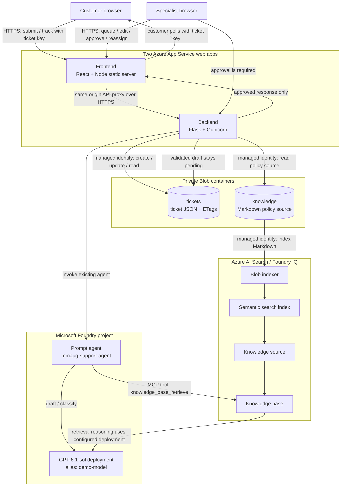
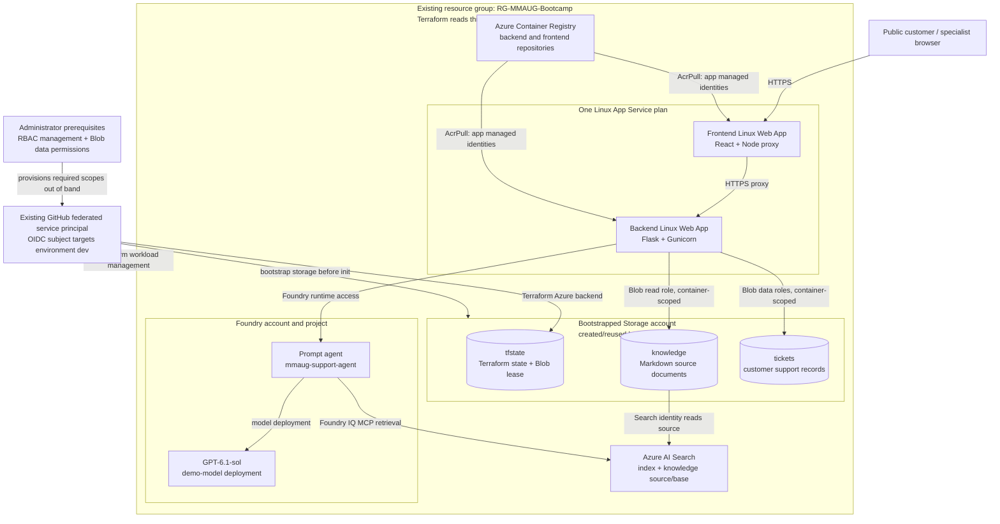
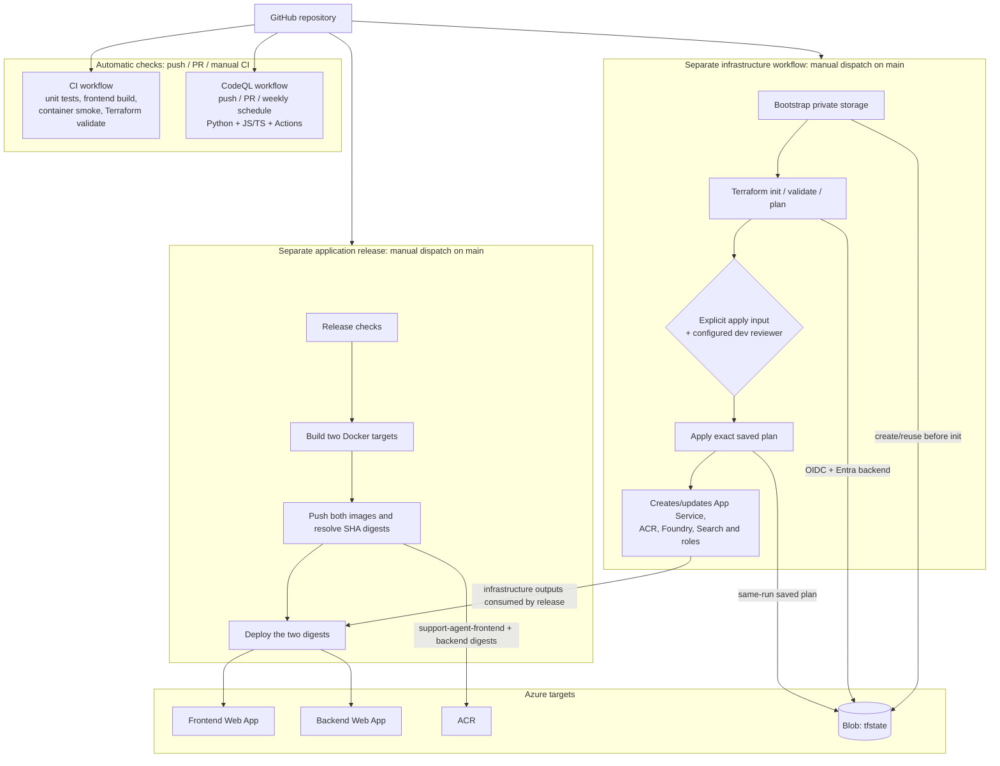
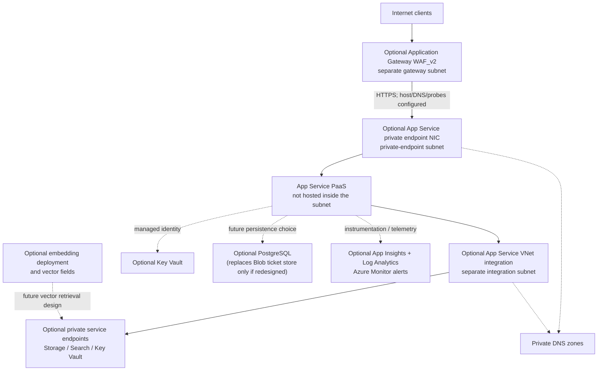

# Expanded architecture views

These diagrams expand the compact architecture in the repository README and
separate four concerns so they are easier to read when presented individually.
They describe the **architecture encoded in the repository**, not proof that
the Azure resources have been deployed.

## 1. Runtime: customer, human review and grounded drafting

[Open the runtime diagram full-size (SVG)](architecture/runtime-flow.svg)

**Important boundary:** the agent drafts and retrieves policy. The backend
validates the draft, and only a specialist can approve customer delivery.
Portal tracking is implemented; email/SMS delivery is not.

**Deployment alias:** `demo-model` is the Azure deployment name. The catalog
model configured behind it is `gpt-6.1-sol`, version `2026-09-29`. The agent
calls the deployment via the Foundry project; the backend also supports an
optional direct model mode.

## 2. Azure resources and ownership boundaries

[Open the Azure resource diagram full-size (SVG)](architecture/azure-resources.svg)

The existing resource group, bootstrap-owned storage account/containers and
Terraform-managed workload have different lifecycle owners. The web apps are
PaaS resources; the diagram does not place them inside a VNet subnet. The
`tfstate` container is not an application data store or a Search source.

## 3. CI, CodeQL, application release and infrastructure delivery

[Open the CI/CD diagram full-size (SVG)](architecture/ci-cd.svg)

**GitHub CI does not deploy.** CodeQL is a separate scanning workflow. The
manual app-release workflow builds/pushes images and updates the App Services.
The manual infrastructure workflow bootstraps state storage, plans and applies
only when explicitly requested and the `dev` environment has its required
review protection. Storage bootstrap may create resources even when Terraform
apply is not selected.

**Azure DevOps is a separate alternative application-release pipeline**, not
the GitHub infrastructure workflow. Its current YAML has `main` triggers and
deployment enabled by default; do not let both release orchestrators target the
same apps at the same time.

## 4. Advanced architecture extensions (not in this deployment)

The following services in an expanded reference diagram are useful topics, but
they are **not currently declared by this repository's Terraform**:

| Extension | Appropriate role | Important diagram correction |
|---|---|---|
| Application Gateway WAF_v2 | Optional internet-facing edge, TLS termination/routing, WAF policy | Show Internet → Gateway/WAF → App Service. Port 80 should redirect to HTTPS rather than appear as the app's normal serving path. |
| VNet, private endpoints, private DNS | Private inbound app access and private service connectivity | App Service remains PaaS outside the subnet. A private endpoint is a NIC in a subnet. Gateway, private endpoint and App Service outbound integration have distinct subnet requirements. |
| Key Vault | Central secret/certificate lifecycle, accessed with managed identity | The current pipeline sets the specialist token as an App Service setting; no Key Vault resource/reference is in the current Terraform. |
| PostgreSQL | Relational ticket storage, if the data model needs transactions/queries | Current ticket persistence is JSON blobs with ETag conditional updates. PostgreSQL is not a second current ticket store. |
| Application Insights / Log Analytics / Azure Monitor | Instrumentation, log aggregation, dashboards and alerts | These are observability paths, not request-path services. They are not currently provisioned/instrumented in this codebase. |
| Embedding model and vector index | Vector/hybrid retrieval if implemented and evaluated | Current Search setup creates a semantic text index; no embedding deployment/vector field is configured. |

[Open the optional extensions diagram full-size (SVG)](architecture/optional-extensions.svg)

Do not treat this extension diagram as an instruction to add every service.
Each addition changes cost, subnet planning, DNS, access control, Terraform
state and operational responsibilities. For Application Gateway to App Service
host-name, DNS, TLS and backend-probe configuration, see Microsoft's
[Application Gateway and App Service guidance](https://learn.microsoft.com/azure/application-gateway/configure-web-app).
For App Service private-link semantics, see
[App Service private endpoints](https://learn.microsoft.com/azure/app-service/overview-private-endpoint).
