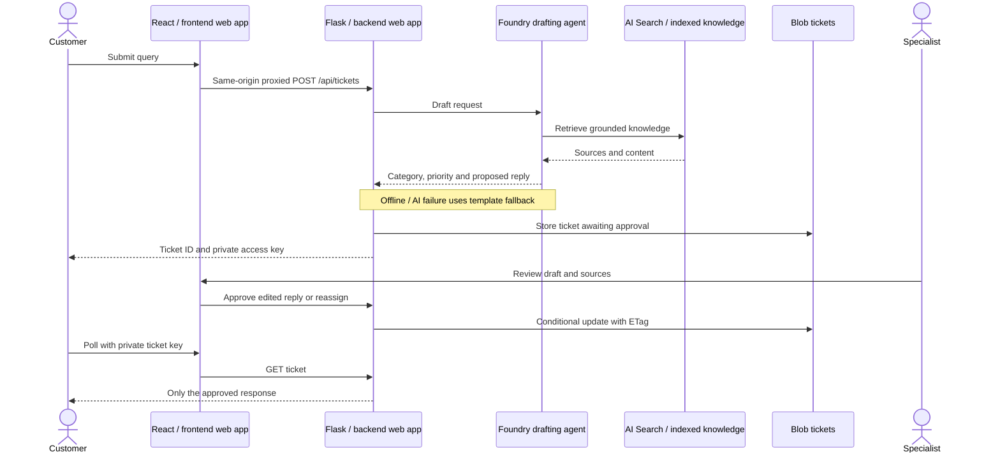
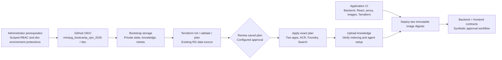

# Architecture: two web apps, indexed knowledge and OIDC infrastructure delivery

The compact component diagram is embedded in the [repository README](../README.md).
For presentation-friendly runtime, Azure resource, CI/CD and optional extension
diagrams, see [expanded architecture views](architecture-expanded.md).
The existing resource group is **RG-MMAUG-Bootcamp**. No VM or new group is
deployed. A shared Linux App Service plan hosts separate frontend and backend
web apps.

## Runtime boundaries

- The **frontend** image serves the built React portal through a non-root Node
  server and proxies `/api` and `/health` to the backend origin.
- The **backend** image runs Flask/Gunicorn as a non-root user. Backend managed
  identity accesses tickets, source knowledge and Foundry; the browser receives
  no Azure credentials.
- The bootstrapped storage account has three private containers. `tfstate`
  contains Terraform state and leases, `knowledge` contains the Markdown source
  and `tickets` contains ticket JSON. Application identities cannot access state.
- **Azure AI Search / Foundry IQ** provides indexed knowledge retrieval from
  Blob to the Foundry agent. Successful source upload is not proof of index
  readiness; setup must verify ingestion and retrieval.
- The Foundry drafting agent/model can suggest a response, but only the human
  specialist can approve customer delivery.

## Infrastructure and application ownership

GitHub environment `dev` must have required reviewers/branch restrictions set
externally. The existing environment was unprotected when inspected. OIDC
authentication is not authorization to manage role assignments or Blob data:
administrator-provisioned permissions remain prerequisites.

Bootstrap storage and the existing RG are outside Terraform destroy ownership.
Existing local state must be reviewed/migrated before the pipeline uses a
remote backend. Application deployment is not atomic across two apps; keep
known-good digest pairs for authorized recovery.

## Local equivalents and limitations

Use [compose.split.yaml](../support-agent/compose.split.yaml) to rehearse the
two-container topology offline. The original default image remains combined
for the introductory single-container lab. Local knowledge/templates need no
Search service or model.

The public backend has no per-user customer authentication or rate limit;
specialists share one token. Replies are portal-only. Storage/Search endpoints
are not private-network isolated. Local folder storage is single-process;
Azure uses Blob. A template fallback does not demonstrate working cloud
retrieval. App Service, Search, ACR, Storage and model usage can incur charges.

See [skills.md](../skills.md) for local/cloud operations and safety boundaries.
